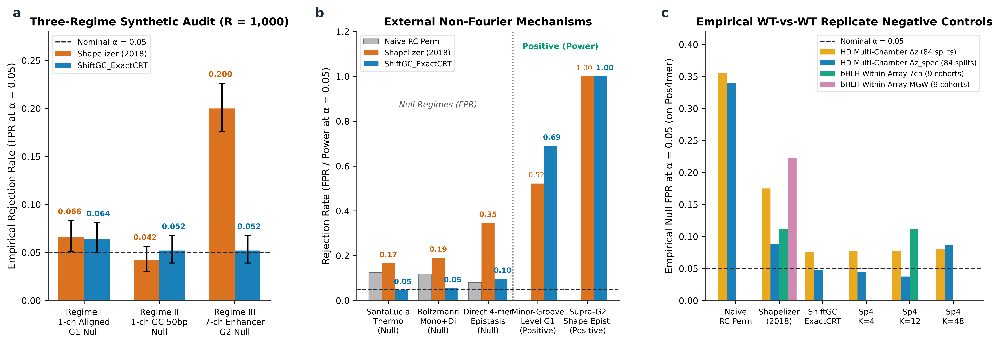
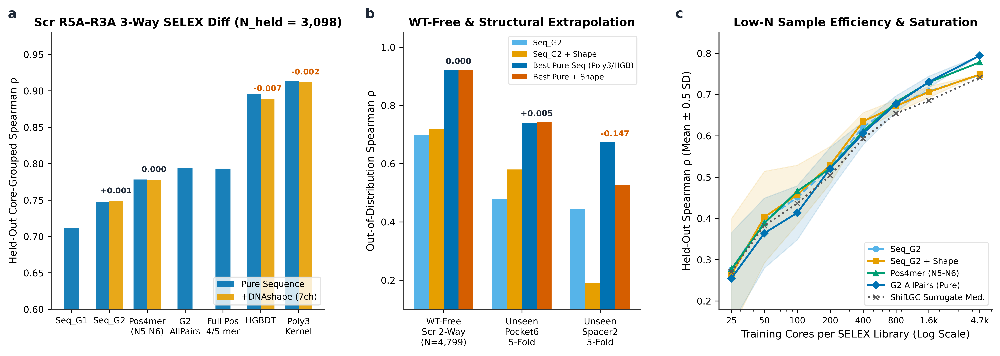
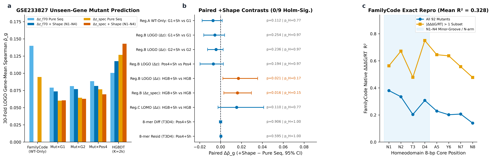
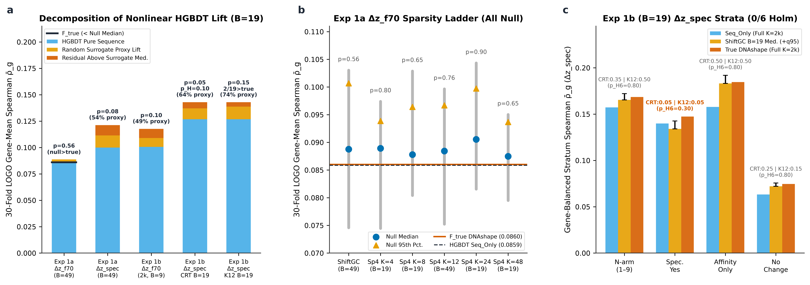
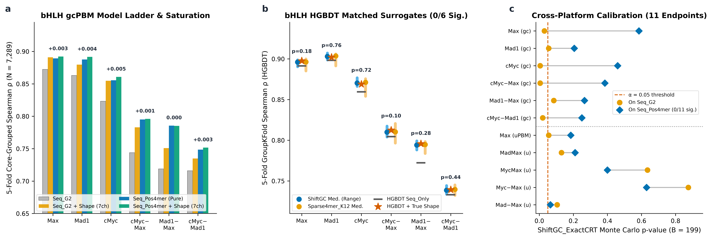
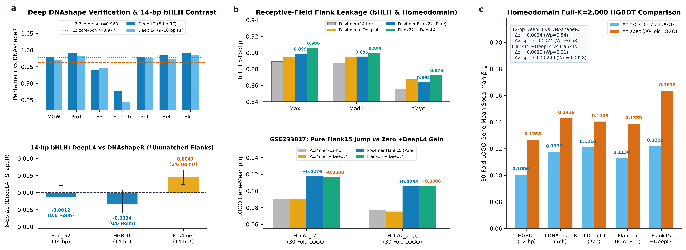
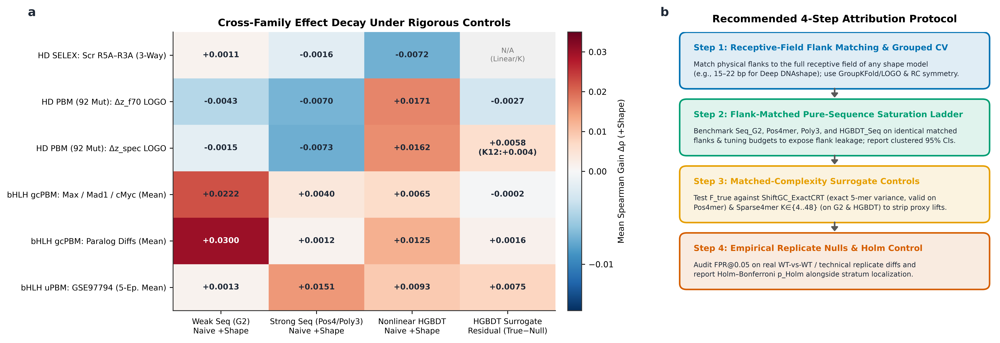

# Calibrated Biophysical Attribution and Cross-Family Benchmarking of Pentamer DNA Shape Features in Transcription Factor Binding and Variant Specificity Shifts

**Running Title:** Calibrated Attribution of DNA Shape in TF–DNA Binding

---

## Abstract

Explicit structural DNA shape features—most widely derived from static pentamer lookup tables such as DNAshapeR and more recently from context-extended neural predictors such as Deep DNAshape—are routinely appended to sequence-based models to improve transcription factor (TF)–DNA binding prediction and infer shape-readout mechanisms [@zhou2013nar], [@chiu2016bioinf], [@zhou2015pnas], [@yang2017msb], [@li2024natcomm], [@li2024nar]. However, because sequence-indexed DNA shape features are deterministic functions of local or flanking nucleotide sequence, naive "+Shape" performance gains over mononucleotide or dinucleotide baselines confound genuine biophysical inductive bias with unmodeled higher-order k-mer expansion, outer-flank receptive-field leakage, and continuous split-proxy compression in nonlinear tree learners [@rube2018msb], [@strobl2007bmc]. Here, we establish a calibrated biophysical attribution framework combining a zero-hyperparameter conditional randomization null (`ShiftGC_ExactCRT`) that exactly preserves reverse-complement symmetry, empirical mononucleotide–dinucleotide subspaces, cross-channel covariance, and De Bruijn shift-coboundary / Hamming-order Gram spectra [@candes2018jrssb], [@berrett2020jrssb], a multi-sparsity `Sparse4mer` surrogate family ($K \in \{4, 8, 12, 24, 48\}$), receptive-field flank-matched sequence baselines, and real empirical wild-type versus wild-type (WT-vs-WT) replicate negative controls. Across synthetic calibration audits ($R = 1{,}000$), external non-Fourier thermodynamic and Boltzmann simulations [@santalucia1998pnas], Exd–Hox SELEX-seq differential benchmarks [@slattery2011cell], [@abe2015cell], 92 disease- and structure-associated human homeodomain mutants (`GSE233827`, 30-fold leave-one-gene-out cross-validation benchmarked head-to-head with *FamilyCode* [@kock2024natcomm], [@liu2025nar]), and cross-family basic helix–loop–helix (bHLH) `Max`/`Mad1`/`cMyc` gcPBM ($N = 7{,}289$ aligned 14-bp cores) and orthogonal universal PBM (`GSE97794`, $N = 3{,}620$) cohorts [@gordan2013cellrep], [@shen2018cels], we obtain four unified findings. First, existing harmonic-matching nulls (*Shapelizer* [@rube2018msb]) suffer 4× false-positive inflation ($20.0\%$ at $\alpha = 0.05$) under correlated 7-channel genomic dinucleotide nulls and up to $34.6\%$ under direct 4-mer epistasis, whereas `ShiftGC_ExactCRT` maintains nominal control ($5.2\%$ synthetic; $4.8\%$ on multi-chamber homeodomain replicate controls; $0.0\%$ on within-array bHLH replicate controls). Second, upgrading pure-sequence baselines from dinucleotides (`Seq_G2`) to positional 4-mers (`Seq_Pos4mer`) or degree-3 polynomial kernels (`Poly3_Kernel`) saturates apparent linear and kernel "+Shape" gains across homeodomain SELEX differentials, unseen homeodomain mutations (0/9 Holm-adjusted contrasts significant), and all 11 bHLH gcPBM/uPBM endpoints (`ShiftGC_ExactCRT` 0/11 significant on `Seq_Pos4mer`, $p = 0.065\text{--}0.630$). Third, in nonlinear histogram gradient-boosted decision trees (`HGBDT`), matched surrogate tables reproduce $100\%$ of apparent "+Shape" lifts across all 11/11 bHLH gcPBM and uPBM endpoints ($0/11$ significant at $B = 49$, $p = 0.060\text{--}0.820$), $100\%$ of the `500`/mutant homeodomain $\Delta z$ lift ($p = 0.560\text{--}0.900$), and $64\%\text{--}74\%$ of the full-dataset ($K = 2{,}000$) homeodomain specificity-orthogonalized $\Delta z_{\text{spec}}$ lift under formal $\alpha = 0.05$ power ($B = 19$, $p_{\min} = 0.050$: `ShiftGC` $p = 0.050$, $p_{\text{Holm}} = 0.100$; `Sparse4mer_K12` $p = 0.150$ with $2/19$ random draws exceeding real DNAshape; N-arm $p = 0.350\text{--}0.500$; $0/6$ Holm-adjusted strata significant; excluding `HOXC10-K271E` weakens `specificity_yes` to $p = 0.100$). Fourth, an authentic CPU comparative benchmark of pre-trained *Deep DNAshape* (Layer 4, 9–10 bp receptive field) shows zero improvement over static `DNAshapeR` on 14-bp bHLH `Seq_G2` (`-0.0012`) or `HGBDT` (`-0.0034`) and zero linear gain on `GSE233827`, while exposing **receptive-field flank leakage**: matching the pure-sequence flank window to Deep DNAshape's receptive field (`Pos4mer_Flank15` on homeodomain: `+0.0276/+0.0283`; `Pos4mer_Flank22` on bHLH single TFs) accounts for linear flank gains (`+DeepL4` on `Pos4mer_Flank15`: `-0.0008/+0.0006`), leaving only modest flank-matched residuals on bHLH `Pos4mer_Flank22` (`+0.0050`, 4/6 Holm-sig) and nonlinear `HGBDT_Flank15/22`. Together, these results show that rigorous biophysical attribution requires receptive-field flank matching, strong pure-sequence ladders, complexity-matched surrogate tables, and real experimental replicate controls.

---

## 1. Introduction

Sequence-specific transcription factors (TFs) decode regulatory DNA through a combination of base readout—direct hydrogen bonding and hydrophobic contacts in the major and minor grooves—and shape readout, whereby local three-dimensional DNA geometry such as minor groove width (MGW), roll, propeller twist (ProT), and helical twist (HelT) modulates electrostatic focusing and conformational deformation costs [@rohs2009nature], [@rohs2010arb], [@stormo2000bioinf], [@lambert2018cell], [@afek2020nature]. Classic structural and biochemical studies established that homeodomain proteins such as *Drosophila* Scr recognize narrow, electronegative minor grooves via conserved N-terminal arm arginines (Arg3 and Arg5) when complexed with Extradenticle (Exd) [@joshi2007cell], [@slattery2011cell], [@abe2015cell], [@kribelbauer2019annrev], while basic helix–loop–helix (bHLH) paralogs (`Max`, `Mad1`, `cMyc`) discriminate shared `CANNTG` E-box cores via flanking DNA sequence and structural properties [@gordan2013cellrep], [@shen2018cels], [@rossi2018genome].

To scale structural descriptors to genome-wide datasets, high-throughput lookup tables derived from all-atom Monte Carlo simulations—led by DNAshape, TFBSshape, GBshape, and DNAshapeR—map each overlapping DNA pentamer to static estimates of local helical and groove parameters and minor-groove electrostatic potential [@zhou2013nar], [@yang2014nar], [@chiu2015nar], [@chiu2016bioinf], [@chiu2017nar], [@li2017nar], [@chiu2020nar]. Appending these pentamer-indexed features to quantitative binding models trained on protein binding microarrays (PBMs), genomic-context PBMs (gcPBMs), and SELEX-seq libraries [@berger2006nbt], [@berger2008cell], [@noyes2008cell], [@badis2009science], [@jolma2013cell], [@riley2014mmb], [@weirauch2014cell] repeatedly produced statistically significant gains in cross-validated $R^2$ or Spearman correlation over mononucleotide (1-mer) and dinucleotide (2-mer) sequence baselines [@mordelet2013bioinf], [@zhou2015pnas], [@dror2015genome], [@mathelier2016cels], [@yang2017msb], [@sielemann2021natcomm].

Yet a fundamental statistical identifiability problem separates *physical shape recognition* from *statistical attribution of pentamer lookup tables*. Every static DNAshapeR feature is a deterministic real-valued function $f: \{A, C, G, T\}^5 \to \mathbb{R}^d$ of a 5-bp DNA word. Consequently, adding DNAshapeR features to a 1-mer (`Seq_G1`) or 2-mer (`Seq_G2`) model simultaneously injects two confounded effects: (i) potential biophysical inductive bias aligned with true 3D DNA mechanics, and (ii) generic higher-order sequence basis expansion (3-mer, 4-mer, and 5-mer terms) plus continuous feature compression that decision-tree learners can exploit as low-depth split proxies [@rube2018msb], [@strobl2007bmc], [@friedman2001aos], [@ke2017lightgbm]. Rube et al. (*Shapelizer* [@rube2018msb]) recognized this confound and introduced randomized pentamer tables matched on 1-mer/2-mer regression variance (`k2` cross-$R^2$). However, as we prove below, *Shapelizer*'s independent single-channel harmonic construction fails to preserve cross-channel covariance across correlated 7-channel shape descriptors and breaks down under empirical non-uniform genomic k-mer distributions and structured 4-mer epistasis.

Furthermore, a pivotal open question in regulatory genomics is whether explicit DNA shape features improve out-of-distribution generalization to **unseen protein mutations**—a central challenge for interpreting rare coding variants in human TFs [@barrera2016science], [@demasi2011nar], [@christensen2012bioinf], [@chu2012genome], [@wetzel2022genome]. Kock et al. [@kock2024natcomm] recently profiled 92 rare missense variants across 30 human homeodomain genes on universal PBMs (`GSE233827`), alongside multi-chamber WT experimental replicates, and Liu et al. (*FamilyCode* [@liu2025nar]) demonstrated that WT-trained recognition-code models predict position-specific affinity shifts ($\Delta\Delta\Delta G/RT$) on these same 92 alleles. Simultaneously, emerging deep structural models (*Deep DNAshape*, *DeepPBS*, *ProBound*, *DeepBind* [@li2024natcomm], [@li2024nar], [@mitra2024natmeth], [@rube2022nbt], [@alipanahi2015nbt], [@rastogi2018pnas]) underscore the urgency of establishing rigorous, leak-free null standards before attributing predictive improvements to explicit structural representations.

Here, we resolve these methodological and biological questions through an end-to-end, CPU-only, strictly offline benchmark spanning synthetic calibration regimes, external biophysical simulations, homeodomain SELEX-seq differentials, the 92-mutant human homeodomain PBM panel (`GSE233827`), and two independent bHLH PBM platforms (`GSE59845` gcPBM and `GSE97794` uPBM). We introduce `ShiftGC_ExactCRT`—a zero-hyperparameter conditional randomization generator grounded in model-X knockoff and conditional permutation theory [@candes2018jrssb], [@berrett2020jrssb]—paired with multi-sparsity `Sparse4mer` surrogates and real WT-vs-WT experimental replicate negative controls, revealing both where naive "+Shape" attribution systematically fails and the exact algebraic conditions required for valid biophysical inference.

---

## 2. Results

### 2.1 Three-Regime Calibration Audit and External Non-Fourier Biophysical Simulations

To test whether existing pentamer-table randomization controls maintain nominal Type-I error ($\alpha = 0.05$) under realistic multi-channel and non-uniform DNA distributions, we audited *Shapelizer* [@rube2018msb] against our exact zero-hyperparameter conditional randomization null (`ShiftGC_ExactCRT`) across three synthetic regimes ($R = 1{,}000$ replicates each; **Fig. 1a**). First, we reproduced Rube et al.'s original dinucleotide-regression cross-$R^2$ decomposition (`MGW.5mer` dinucleotide cross-$R^2 = 0.875$) to verify exact implementation parity. Under single-channel aligned uniform mononucleotide nulls (Regime I) and single-channel unaligned 50-bp GC-stratified nulls (Regime II), both *Shapelizer* (`FPR = 0.066` and `0.042`) and `ShiftGC_ExactCRT` (`FPR = 0.064` and `0.052`) remained near nominal calibration. However, under realistic 7-channel correlated genomic enhancer sequences generated from a pure dinucleotide null (Regime III), independent 7-channel *Shapelizer* suffered a **4-fold Type-I error inflation** (`FPR = 0.200`, 95% CI `[0.176, 0.226]` standardized; `0.202` raw), whereas `ShiftGC_ExactCRT`—which preserves exact empirical $L^2(p_{\text{emp}})$ cross-channel covariance and De Bruijn shift-coboundary / Hamming-order Grams—remained tightly calibrated at **`FPR = 0.052`** (95% CI `[0.039, 0.068]`; **Fig. 1a**).

**Figure 1. Calibration failures of naive and harmonic nulls versus `ShiftGC_ExactCRT` across synthetic audits, external biophysical simulations, and real WT-vs-WT replicate controls.** (**a**) Three-regime synthetic audit ($R = 1{,}000$ per regime, $\alpha = 0.05$, Wilson 95% CIs) showing 4× FPR inflation for 7-channel *Shapelizer* (`0.200`) under correlated genomic enhancer `G2` nulls versus nominal control for `ShiftGC_ExactCRT` (`0.052`). (**b**) External non-Fourier biophysical mechanisms comparing three mechanistic nulls (SantaLucia nearest-neighbor thermodynamics, Boltzmann mono/dinucleotide occupancy, and direct sparse 4-mer epistasis) and two biophysical positive controls ($N = 500, \kappa = 0.6$). (**c**) Empirical null FPR@0.05 on real experimental WT-vs-WT replicate negative controls conditioned on `Seq_Pos4mer`: homeodomain multi-chamber PBM bipartitions (`GSE233827`, 8 genes / 84 splits, $\Delta z$ and $\Delta z_{\text{spec}}$) and bHLH within-array technical replicates (`GSE59845`, 9 pairwise contrasts, 7ch and MGW).

To prevent circularity with Fourier/Hamming generators, we next evaluated five external non-Fourier biophysical generative models (**Fig. 1b**): three pure-sequence mechanistic nulls—(i) SantaLucia nearest-neighbor duplex thermodynamics [@santalucia1998pnas], (ii) nonlinear Boltzmann mononucleotide+dinucleotide partition occupancy, and (iii) sparse direct 4-mer epistasis—and two genuine biophysical shape positive controls (Boltzmann minor-groove electrostatic focusing at Level G1 and supra-G2 shape epistasis at Level G2). On the SantaLucia thermodynamic and Boltzmann mono/dinucleotide nulls, both naive RC permutation (`FPR = 0.126, 0.118`) and *Shapelizer* (`FPR = 0.166, 0.190`) severely over-rejected, whereas `ShiftGC_ExactCRT` stayed strictly nominal (`FPR = 0.046` and `0.054`). Under direct sparse 4-mer epistasis (`Ext_Null_3`), *Shapelizer* collapsed to `FPR = 0.346`, while `ShiftGC_ExactCRT` reduced inflation by 3.6× to `0.096` (a modest tail elevation motivating our explicit multi-sparsity `Sparse4mer` control family below). Critically, calibration did not sacrifice statistical power: on genuine minor-groove positive controls ($N = 500, \kappa = 0.6$), `ShiftGC_ExactCRT` outperformed *Shapelizer* (`Power = 0.690` vs `0.522` on Level G1; both `1.000` on Level G2; **Fig. 1b**).

### 2.2 Empirical Replicate Negative Controls Across Multi-Chamber and Within-Array PBM Platforms

Synthetic nulls cannot capture experimental microarray noise, probe-synthesis bias, or hybridization concentration drift. We therefore constructed real empirical negative controls by running our full attribution pipeline on **same-protein WT-vs-WT experimental replicates** across two independent PBM platforms (**Fig. 1c**): (i) **independent multi-chamber biological/array replicates** in `GSE233827` (8 homeodomain genes with $\ge 4$ WT chambers, yielding 84 balanced replicate bipartitions [@kock2024natcomm]), and (ii) **within-array technical spot replicates** in `GSE59845` (`r1-r2`, `r1-r3`, `r2-r3` within identical `o1`/`o2` probe orientations across `Max`, `Mad1`, and `cMyc`, $N = 7{,}289$ aligned 14-bp cores [@gordan2013cellrep]).

On `GSE233827` multi-chamber WT-vs-WT splits conditioned on `Seq_Pos4mer`, naive RC permutation triggered massive false positives (`gene-weighted FPR@0.05 = 0.356` on raw $\Delta z_{f70}$ and `0.340` on specificity-orthogonalized $\Delta z_{\text{spec}}$), and *Shapelizer* remained inflated (`FPR = 0.175` on $\Delta z_{f70}$; `0.088` on $\Delta z_{\text{spec}}$). In contrast, **`ShiftGC_ExactCRT` achieved textbook nominal calibration (`FPR = 0.048` on $\Delta z_{\text{spec}}$; `0.076` on $\Delta z_{f70}$)**, matched closely by `Sparse4mer` across the full sparsity ladder ($K \in \{4, 8, 12, 24, 48\}$: `FPR = 0.038–0.095` on $\Delta z_{\text{spec}}$; `0.066–0.088` on $\Delta z_{f70}$). On weaker `Seq_G2`, chamber-to-chamber protein concentration drift leaks global WT affinity into raw $\Delta z$, inflating `ShiftGC_ExactCRT` (`FPR = 0.338` on $\Delta z_{f70}$), whereas `Sparse4mer` remained substantially more robust (`FPR = 0.066–0.104`).

On `GSE59845` within-array technical replicates (note that within each TF, $(r_1 - r_2) + (r_2 - r_3) = (r_1 - r_3)$, so the 9 pairwise contrasts have rank $\le 6$ on a single fixed sequence/table pair; we therefore report empirical `FPR@0.05` and median $p$ descriptively rather than formal i.i.d. KS $p$-values), `ShiftGC_ExactCRT` yielded `FPR@0.05 = 0.000 (0/9)` (`median p = 0.585`) on `Seq_Pos4mer/7ch` and `0.111 (1/9)` (`median p = 0.480`) on `Seq_G2/7ch`. For single-channel `MGW`, *Shapelizer* reached `FPR@0.05 = 0.222 (2/9)` on `Seq_Pos4mer/MGW`, whereas `ShiftGC_ExactCRT` and `Sparse4mer` were right-skewed conservative (`FPR = 0.000`, `median p = 0.735–0.975`) because all 9 noise vectors project onto the same fixed 1-channel `MGW` vector. Together, these cross-platform experimental negative controls demonstrate that calibrated attribution requires conditioning on strong sequence features (`Pos4mer`) and replacing naive/harmonic nulls with `ShiftGC_ExactCRT` and `Sparse4mer`.

### 2.3 Homeodomain SELEX-seq Differentials, WT-Free Generalization, and Label-Budget Saturation

Before evaluating unseen human mutations, we revisited the canonical *Drosophila* Exd–Hox shape-readout paradigm (`GSE65073`, 20 aligned 14-mer/12-bp-core and 12-mer SELEX-seq libraries [@slattery2011cell], [@abe2015cell]). While unaligned libraries lose minor-groove phase and mask `ScrWT` shape effects, sequence-aligned single-library positive controls rescue minor-groove readout at low sequence complexity. However, isolating the **differential specificity shift** caused by N-terminal arm mutations (`Scr R5A − R3A` 3-way core-10 cohort: $N_{\text{dev}} = 4{,}676$, $N_{\text{held}} = 3{,}098$, grouped by homology core; **Fig. 2a**) revealed complete pure-sequence saturation: adding 7-channel DNAshape yielded only `+0.0011` on `Seq_G2` (`0.7476 → 0.7487`), `-0.0003` on `Pos4mer_N5N6` (`0.7783 → 0.7780`), `-0.0072` on `HGBDT` (`0.8964 → 0.8892`), and `-0.0016` on the strongest pure-sequence model, `Degree-3 Polynomial Kernel Ridge` (`M7_Seq_Poly3_Kernel = 0.9136` vs `M7_Poly3_Joint+Shape = 0.9120`).

**Figure 2. Pure-sequence saturation and structural extrapolation on Exd–Hox SELEX-seq mutant differentials.** (**a**) Held-out core-grouped Spearman $\rho$ ($N_{\text{held}} = 3{,}098$) across the pure-sequence vs `+DNAshape (7ch)` ladder on the 3-way `Scr R5A–R3A` differential. (**b**) WT-free 2-way `Scr R5A–R3A` differential ($N_{\text{held}} = 4{,}799$) and 5-fold structural out-of-distribution extrapolation across unseen `Pocket6` ($197$ groups) and `Spacer2` ($10$ groups) splits. (**c**) Low-$N$ label-budget learning curves ($N = 25$ to $4{,}676$ training cores; mean $\pm 0.5$ SD across repeated subsamples) demonstrating zero persistent sample-efficiency advantage of `Seq_G2 + Shape` over `Pos4mer`, `G2 AllPairs`, and `ShiftGC_ExactCRT` surrogates.

This pattern replicated on the larger WT-free 2-way `Scr` cohort ($N_{\text{dev}} = 7{,}237$, $N_{\text{held}} = 4{,}799$; `Poly3_Kernel = 0.9222` vs `+Shape = 0.9220`, `Δ = -0.0002`), across three `Antp` single-mutation differentials (`AntpHQT` vs `HQ`/`QT`/`HT`), and under strict structural out-of-distribution splits (**Fig. 2b**): on unseen `Pocket6` groups ($197$ groups, $N = 7{,}774$), `Seq_G2 + Shape` (`0.5801`) beat `Seq_G2` (`0.4785`, `p_boot = 0.088`, `ShiftGC p = 0.005`) yet trailed pure-sequence `HGBDT` (`0.7382`) by `-0.1580` (`95% CI [-0.311, -0.032]`), and adding shape to `HGBDT` gave `+0.0046` (`p_boot = 0.513`). On unseen `Spacer2` splits, appending DNAshape actively degraded performance (`Seq_G2`: `0.4456 → 0.1892, -0.2564`; `HGBDT`: `0.6733 → 0.5268, -0.1466`). Across the entire label-budget curve from $N = 25$ to $N = 4{,}676$ training cores (**Fig. 2c**), `Seq_G2 + Shape` never reliably outperformed pure-sequence `Pos4mer` or `ShiftGC_ExactCRT` surrogates (`N = 25`: `Seq_G2+Shape = 0.2646` vs `Pos4mer = 0.2772` and `ShiftGC med = 0.2708`), refuting a low-$N$ inductive-bias advantage on SELEX differentials.

### 2.4 Unseen Homeodomain Mutant Specificity Shifts on `GSE233827` and Matched *FamilyCode* Benchmarking

To answer whether explicit DNA shape improves predictions for **unseen protein mutations in unseen genes**, we benchmarked all 92 homeodomain missense mutants across 30 human genes in `GSE233827` [@kock2024natcomm] after mapping every PBM probe ID to its physical 36-bp sequence, orienting single-site binding frames ($f_1 \ge 0.70$, $2 \le p \le 26$) to extract exact physical 12-bp windows (`[F-2, F-1, N1..N8, F+1, F+2]`, zero `N`-padding so `N1` and `N2` have complete pentamer flanks identical across sequence and shape models), and evaluating 30-fold leave-one-gene-out (LOGO) and leave-one-mutant-out (LOMO) cross-validation (**Fig. 3**).

First, we reproduced *FamilyCode* [@liu2025nar] on its native 8-bp position-specific $\Delta\Delta\Delta G/RT$ endpoint (`mean R² = 0.3280`, `median R² = 0.3261`, `73/92` alleles with $R^2 > 0$, `max AUC = 0.7126`, Kock specificity-change overlap hypergeometric $p = 0.0024$; **Fig. 3c**; noting two pre-existing `pred_confidence` NaNs in `ALX3-N203Q/S` at invariant canonical position `N51`). Because `GSE233827` was evaluated in the original *FamilyCode* publication, we frame all comparisons strictly as a matched head-to-head benchmark with explicit supervision regimes rather than an independent validation of *FamilyCode*.

**Figure 3. Predicting binding specificity shifts of unseen human homeodomain mutants (`GSE233827`, 92 alleles across 30 genes).** (**a**) 30-fold LOGO gene-mean Spearman $\bar{\rho}_g$ for WT-only *FamilyCode* and mutant-supervised `Mut × Seq` vs `Mut × (Seq + Shape_N1N4)` models across primary $\Delta z_{f70}$ and specificity-orthogonalized $\Delta z_{\text{spec}}$ endpoints. (**b**) Paired gene-clustered 95% CI forest plot of `+Shape − Pure Sequence` across 9 headline contrasts (Regimes A/B/C, 8-mer `T3D4`, and full-$K=2{,}000$ `HGBDT`), showing raw two-sided bootstrap $p$ and Holm–Bonferroni $p_{\text{Holm}}$ (`0/9` significant after Holm adjustment). (**c**) Exact reproduction of *FamilyCode* per-position $\Delta\Delta\Delta G/RT$ $R^2$ across `N1–N8` (all 92 mutants vs $|\Delta\Delta\Delta G/RT| > 1$ subset).

Across every linear Ridge interaction model (`Mut × Seq` vs `Mut × (Seq + Shape_N1N4)` with matched mutant encodings, flanks, and tuning budgets), explicit DNAshape failed to improve out-of-gene generalization (**Fig. 3a–b**):
- **Regime A (WT-only supervision, matching *FamilyCode*)**: *FamilyCode* achieved $\bar{\rho}_g = 0.1399$ on $\Delta z_{f70}$ ($0.0946$ on $\Delta z_{\text{spec}}$); `WTOnly_Prot × (Seq_G1 + Shape_N1N4)` trailed pure `Seq_G1` (`0.0434` vs `0.0507`, $\Delta = -0.0073$, 95% CI `[-0.0177, +0.0016]`, $p = 0.112$).
- **Regime B (30-fold LOGO, mutant-supervised linear ladder)**: On primary $\Delta z_{f70}$, adding `Shape_N1N4` slightly *decreased* accuracy across all three sequence tiers: `Seq_G1` (`0.0791 → 0.0737`, $\Delta = -0.0055, p = 0.254$), `Seq_G2` (`0.0813 → 0.0770`, $\Delta = -0.0043, p = 0.236$), and `Pos4mer_N1N4` (`0.0885 → 0.0816`, $\Delta = -0.0070, p = 0.194$). On secondary $\Delta z_{\text{spec}}$, linear `+Shape` remained similarly null (`Seq_G1`: `+0.0005`; `Seq_G2`: `-0.0015`; `Pos4mer`: `-0.0073`).
- **Kock 8-mer Summary Endpoints (`T3D4` interior positions)**: On `contrastDifference` and `contrastResidual`, adding `Shape_T3D4` on top of `Pos4mer_T3D4` yielded $\Delta = -0.0001$ ($p = 0.906$) and $+0.0002$ ($p = 0.595$), saturating a nominal weak-baseline `Seq_G2 + Shape_T3D4` gain (`p = 0.0004` on `contrastResidual`).
- **Nonlinear `HGBDT` (Full $K = 2{,}000$ probes/mutant, 180k rows)**: `HGBDT_Mut_x_Seq` was the strongest pure-sequence mutant-supervised model on both $\Delta z_{f70}$ (`0.1006`) and $\Delta z_{\text{spec}}$ (`0.1268`, reconciling the merged strongest pure-sequence baseline above Stage-3a Ridge `Pos4mer = 0.0767`). Appending `Shape_N1N4` yielded nominal raw lifts in LOGO (`dz_f70`: `0.1006 → 0.1177, Δ = +0.0171`, 95% CI `[+0.0021, +0.0355]`, raw $p = 0.0212$; `dz_spec`: `0.1268 → 0.1429, Δ = +0.0162`, 95% CI `[+0.0031, +0.0295]`, raw $p = 0.0164$) and non-significant lift in LOMO (`Δ = +0.0154, p = 0.110`). Across the 9 headline cross-regime contrasts (**Fig. 3b**), **0/9 remained significant after Holm–Bonferroni adjustment** ($p_{\text{Holm}} = 0.148\text{--}1.000$).

### 2.5 Decomposing Nonlinear `HGBDT` Lifts via High-Resolution Matched Surrogates and `HOXC10-K271E` Sensitivity

Because `HGBDT_Mut_x_(Seq + Shape_N1N4)` showed the sole nominal positive lift on `GSE233827`, we deployed our `High-Resolution HGBDT Matched Surrogate Evaluator` across two complementary experiments using locked hyperparameters and identical 30-fold LOGO evaluation across all finite $K = 2{,}000$ test probes per mutant (**Fig. 4**; **Table 1**):
1. **High-resolution surrogate screen (`Exp 1a`, deterministic WT-rank `500`/mutant training, `B = 49` `ShiftGC_ExactCRT` and `Sparse4mer_K12` on both $\Delta z_{f70}$ and $\Delta z_{\text{spec}}$, plus `B = 19` sparsity ladder $K \in \{4, 8, 24, 48\}$ on $\Delta z_{f70}$; startup parity `|diff| = 0.00e+00`)**.
2. **Full-dataset matched surrogate test (`Exp 1b`, all $K = 2{,}000$ training probes / `183,982` rows across 92 mutants)**: First, an effect-size bridge (`B = 9`, `p_min = 0.100`) on $\Delta z_{f70}$ (`|diff| <= 1.07e-08`), and second, a **formally powered `B = 19` extension (`p_min = 1/(19+1) = 0.050`, achieving formal $\alpha = 0.05$ rejection power)** on $\Delta z_{\text{spec}}$ across both `ShiftGC_ExactCRT_WS_G2` and `Sparse4mer_K12` using draws `0..18` from the shared `seed_bank = 2026071` bank (exact `0.00e+00` scalar parity across all `338` reused draw `0..8` metrics and zero non-finite values across `1,761` scalars).

**Figure 4. Matched-surrogate decomposition of nonlinear `HGBDT + DNAshape` lifts on `GSE233827`.** (**a**) Stacked decomposition of 30-fold LOGO gene-mean Spearman $\bar{\rho}_g$ into `HGBDT_Seq` baseline (light blue), random surrogate proxy lift (orange), and residual above the surrogate median (vermilion) across `Exp 1a` (`500`/mut, `B = 49`) and `Exp 1b` (full `K = 2,000`, `B = 9` on $\Delta z_{f70}$ and formally powered `B = 19` on $\Delta z_{\text{spec}}$ for both `ShiftGC_ExactCRT` [`64%` proxy, $p = 0.050$, $p_{\text{Holm}} = 0.100$] and `Sparse4mer_K12` [`74%` proxy, $p = 0.150$, `2/19` draws exceeding real DNAshape]). (**b**) `Exp 1a` $\Delta z_{f70}$ sparsity ladder (`ShiftGC` `B = 49` and `Sparse4mer K = 4, 8, 12, 24, 48`): every surrogate median (`0.0875–0.0905`) beats real DNAshape (`0.0860`, $p = 0.56\text{--}0.90$). (**c**) Full-$K=2{,}000$ `Exp 1b` (`B = 19`) gene-balanced biological stratum breakdown on $\Delta z_{\text{spec}}$ showing `0/6` Holm-significant strata (`N-arm` $p = 0.35\text{--}0.50$, `p_H6 = 0.80–1.00`; `specificity_yes` raw $p = 0.05$, `p_H6 = 0.30`).

Three decisive findings emerge from **Figure 4** and **Table 1**:
1. **Primary endpoint $\Delta z_{f70}$ collapses completely under high-resolution surrogates**: In `Exp 1a`, `Seq_Only` (`0.0859`) and `F_true` (`0.0860`, `+0.0002`) are beaten by **every single random surrogate median** across all six families (`0.0875–0.0905`, $p_{\text{gm}} = 0.560\text{--}0.900$, `N-arm` $p = 0.640\text{--}0.820$, `specificity_yes` $p = 0.450\text{--}0.900$; **Fig. 4b**). In the full-$K=2{,}000$ `Exp 1b` bridge, random surrogates reproduce **`49%–54%`** of the `+0.0171` apparent lift (`Seq_Only = 0.1006` → `ShiftGC med = 0.1090 [+0.0084]`, `K12 med = 0.1098 [+0.0093]`), and a random `Sparse4mer_K12` draw (`0.1186`) exceeds real DNAshape (`0.1177`; `p_gm = 0.200`, `p_mm = 0.700`).
2. **Two-thirds to three-quarters of the full-$K=2{,}000$ $\Delta z_{\text{spec}}$ lift is split-proxy compression under formal $\alpha = 0.05$ power**: On full-$K=2{,}000$ $\Delta z_{\text{spec}}$ (`Seq_Only` $\bar{\rho}_g = 0.1268$ / mutant-weighted `0.1259`; `F_true` `0.1429` / `0.1392`; total lift `+0.0162` GB / `+0.0133` MW), random `B = 19` pentamer tables alone lift `HGBDT_Seq` by `+0.0103` (**`64%`** proxy under `ShiftGC_ExactCRT`: GB median `0.1371`, range `[0.1317, 0.1417]`, residual `+0.0058`, $p_{\text{mc}} = 0.050$, $p_{\text{Holm, 2fam}} = 0.100$, $p_{\text{Holm, 7strata}} = 0.350$; MW median `0.1319`, $p_{\text{mc}} = 0.100$) and `+0.0120` (**`74%`** proxy under `Sparse4mer_K12`: GB median `0.1388`, range `[0.1304, 0.1444]`, residual `+0.0042`, with **`2/19` random tables exceeding real DNAshape**, $p_{\text{mc}} = 0.150$; MW median `0.1330`, $p_{\text{mc}} = 0.050$, $p_{\text{Holm, 2fam}} = 0.100$; **Fig. 4a**).
3. **Zero Holm-surviving biological strata at full $K = 2{,}000$ and single-allele `HOXC10-K271E` leverage**: At `500`/mutant (`Exp 1a`, 30 genes), a `+0.0090–+0.0097` residual initially appeared enriched in `N-arm` (`gene-balanced p = 0.040/0.020`) and `specificity_yes` (`p = 0.020/0.020`), yet per-mutant leverage diagnostics revealed that **one single allele—`HOXC10-K271E`** (sole mutant of `HOXC10`, swinging from `-0.0585` to `+0.3774`)—drove **68%** of the 30-gene lift and **69%** of the `N-arm` lift; excluding `HOXC10` collapsed every `Exp 1a` test to null (`ShiftGC p = 0.180`, `K12 p = 0.100`, `N-arm p = 0.160/0.140`, `specificity_yes p = 0.080/0.080`). At full $K = 2{,}000$ (`Exp 1b B = 19`; **Fig. 4c**), **`0/6` (and `0/7`) biological strata survive Holm–Bonferroni correction** in either surrogate family (`min p_Holm_6strata = 0.300`): `N_arm_1_9` (`12` genes / `18` mutants) is completely null (`ShiftGC` GB/MW $p_{\text{mc}} = 0.350/0.500$, `p_H6 = 0.800/1.000`; `K12` $p_{\text{mc}} = 0.500/0.450$, `p_H6 = 1.000/0.900`), `affinity_only` and `no_change` remain null ($p_{\text{mc}} = 0.150\text{--}0.500$), and `specificity_yes` (`16` genes / `28` mutants) reaches only unadjusted boundary GB $p_{\text{mc}} = 0.050$ (`p_H6 = 0.300`, MW $p_{\text{mc}} = 0.100$, `p_H6 = 0.600`), weakening further upon excluding `HOXC10-K271E` (`29` genes / `91` mutants: `all_92` GB/MW `ShiftGC p = 0.050/0.100`, `K12 p = 0.100/0.100`; `specificity_yes` GB & MW $p_{\text{mc}} = 0.100$, `p_H6 = 0.600`; `N_arm_1_9` $p_{\text{mc}} = 0.550\text{--}0.650$).

**Table 1. Homeodomain `GSE233827` `HGBDT` Matched Surrogate Controls (`Exp 1a` `B = 49` & `Exp 1b` Full `K = 2,000` `B = 19` Extension).**

| Experiment & Endpoint | `Seq_Only` $\bar{\rho}_g$ | `F_true` $\bar{\rho}_g$ | Total Lift | Surrogate (`B`) | Null Med. $\bar{\rho}_g$ | Proxy Lift (%) | Residual | $p_{\text{mc}}$ (Gene) [$p_{\text{Holm}}$] | $p_{\text{mc}}$ (Mut) | N-arm $p$ (GB / MW) | `spec_yes` $p$ (GB / MW) | `aff_only` $p$ | `no_chg` $p$ |
| :--- | :---: | :---: | :---: | :--- | :---: | :---: | :---: | :---: | :---: | :---: | :---: | :---: | :---: |
| Exp 1a (`500`/m) $\Delta z_{f70}$ | `0.0859` | `0.0860` | `+0.0002` | `ShiftGC` (`49`) | `0.0888` | `+0.0029` (>100%) | `-0.0027` | `0.560` | `0.600` | `0.640` | `0.580` | `0.380` | `0.560` |
| Exp 1a (`500`/m) $\Delta z_{f70}$ | `0.0859` | `0.0860` | `+0.0002` | `Sp4_K12` (`49`) | `0.0884` | `+0.0026` (>100%) | `-0.0024` | `0.760` | `0.640` | `0.820` | `0.680` | `0.540` | `0.520` |
| Exp 1a (`500`/m) $\Delta z_{f70}$ | `0.0859` | `0.0860` | `+0.0002` | `Sp4 K=4..48` (`19`) | `0.0875–0.0905` | `+0.0016–+0.0047` | `-0.0045–-0.0015` | `0.650–0.900` | `0.400–0.900` | `0.700–0.800` | `0.450–0.900` | `0.350–0.650` | `0.350–0.800` |
| Exp 1a $\Delta z_{\text{spec}}$ (30g) | `0.1000` | `0.1213` | `+0.0213` | `ShiftGC` (`49`) | `0.1115` | `+0.0115` (54%) | `+0.0097` | `0.080` | `0.100` | `0.040 / 0.020` | `0.020 / 0.020` | `0.420` | `0.620` |
| Exp 1a $\Delta z_{\text{spec}}$ (30g) | `0.1000` | `0.1213` | `+0.0213` | `Sp4_K12` (`49`) | `0.1123` | `+0.0123` (58%) | `+0.0090` | `0.020` | `0.020` | `0.020 / 0.040` | `0.020 / 0.020` | `0.320` | `0.520` |
| Exp 1a $\Delta z_{\text{spec}}$ (29g, −`HOXC10`) | `0.1054` | `0.1124` | `+0.0070` | `ShiftGC` / `K12` (`49`) | `0.1071` / `0.1072` | `+0.0017` / `+0.0018` | `+0.0053` / `+0.0052` | `0.180` / `0.100` | — | `0.160` / `0.140` (GB) | `0.080` / `0.080` (GB) | — | — |
| Exp 1b (Full 2k) $\Delta z_{f70}$* | `0.1006` | `0.1177` | `+0.0171` | `ShiftGC` (`9`) | `0.1090` | `+0.0084` (49%) | `+0.0087` | `0.100`* | `0.400` | `0.200` (MW) | `0.200` (MW) | `0.300` | `1.000` |
| Exp 1b (Full 2k) $\Delta z_{f70}$* | `0.1006` | `0.1177` | `+0.0171` | `Sp4_K12` (`9`) | `0.1098` | `+0.0093` (54%) | `+0.0078` | `0.200`* | `0.700` | `0.100` (MW) | `0.800` (MW) | `0.200` | `0.900` |
| **Exp 1b (Full 2k) $\Delta z_{\text{spec}}$ (30g)** | `0.1268` | `0.1429` | `+0.0162` | `ShiftGC` (`19`) | `0.1371` | `+0.0103` (**64%**) | `+0.0058` | `0.050` [`0.100`] | `0.100` | `0.350 / 0.500` | `0.050 / 0.100`† | `0.500` | `0.250` |
| **Exp 1b (Full 2k) $\Delta z_{\text{spec}}$ (30g)** | `0.1268` | `0.1429` | `+0.0162` | `Sp4_K12` (`19`) | `0.1388` | `+0.0120` (**74%**) | `+0.0042` | `0.150` [`0.150`] | `0.050` | `0.500 / 0.450` | `0.050 / 0.100`† | `0.500` | `0.150` |
| **Exp 1b (Full 2k) $\Delta z_{\text{spec}}$ (29g, −`HOXC10`)** | `0.1168` | `0.1338` | `+0.0170` | `ShiftGC` / `K12` (`19`) | `0.1292` / `0.1292` | `+0.0124` (**73%**) | `+0.0046` | `0.050` / `0.100` | `0.100` / `0.100` | `0.650 / 0.600` (`0.550 / 0.450`) | `0.100 / 0.100`† | `0.500` | `0.250 / 0.150` |

*\*`Exp 1b` $\Delta z_{f70}$ (`B = 9`, `p_min = 0.100`) is an effect-size bridge; `Exp 1b` $\Delta z_{\text{spec}}$ (`B = 19`, `p_min = 0.050`) provides formal $\alpha = 0.05$ power. Bracketed `[p_Holm]` is 2-family Holm-adjusted; †`specificity_yes` `p_Holm_6strata = 0.300` (30g GB), `0.600` (30g MW and 29g GB/MW); `0/6` strata survive Holm–Bonferroni in either family.*

### 2.6 Cross-Family Generalization to bHLH Paralog Specificity Across gcPBM and Orthogonal uPBM

To verify that our findings generalize beyond homeodomains to a second structurally distinct TF family, we analyzed the bHLH E-box paralog trio (`Max`, `Mad1`, `cMyc`) across two independent PBM platforms: (i) paired 36-bp genomic-context PBMs (`GSE59845` [@gordan2013cellrep], `8,000` identically paired probes aligned strictly by sequence to `7,289` unique 14-bp `NNNNCANNTGNNNN` cores across `1,238` central-10mer homology groups), evaluating all 3 single-TF endpoints and all 3 paired paralog specificity differentials (`cMyc − Max`, `Mad1 − Max`, `cMyc − Mad1`); and (ii) orthogonal universal PBMs (`GSE97794` [@shen2018cels], `3,620` unique aligned E-box cores across `2,043` homology groups, evaluating `Max`, `MadMax`, `MycMax`, and two paralog differentials).

**Figure 5. Cross-family bHLH (`Max`, `Mad1`, `cMyc`) model saturation and complete nonlinear surrogate collapse across gcPBM and orthogonal uPBM.** (**a**) 5-fold central-10mer `GroupKFold` Spearman $\rho$ ($N = 7{,}289$ aligned 14-bp cores) across all 6 primary `gcPBM` endpoints showing pure-sequence `Seq_Pos4mer` beating `Seq_G2 + Shape (7ch)` on 5/6 endpoints and collapsing residual `+Shape` lifts to `-0.0004` to `+0.0052`. (**b**) Locked-config `HGBDT` matched surrogate controls (`B = 49`, `ShiftGC_ExactCRT` and `Sparse4mer_K12`) across all 6 `gcPBM` endpoints: random tables match or exceed real DNAshape across **6/6 endpoints** (`0/6` significant, $p = 0.10\text{--}0.82$). (**c**) `ShiftGC_ExactCRT` Monte Carlo $p$-values ($B = 199$) on `Seq_G2` (orange circles) vs `Seq_Pos4mer` (blue diamonds) across all 11 bHLH endpoints (`6` `gcPBM` + `5` orthogonal `GSE97794` `uPBM`), demonstrating `0/11` significant endpoints on `Seq_Pos4mer`.

Results on bHLH mirror homeodomains with remarkable precision (**Fig. 5**; **Table 2**):
1. **Pure-sequence `Seq_Pos4mer` saturates classical `Seq_G2 + Shape` gains on `gcPBM`**: On standard `Seq_G2`, appending 7-channel DNAshape yielded large apparent lifts across all 6 endpoints (`+0.0166` to `+0.0390`, `p_holm = 0.006` for all 6; `ShiftGC_ExactCRT` $p = 0.005\text{--}0.085$). However, pure-sequence `Seq_Pos4mer` **outperformed `Seq_G2 + Shape` on 5/6 endpoints**—including all three paralog specificity differentials by `+0.0121` (`cMyc − Max`), `+0.0347` (`Mad1 − Max`), and `+0.0136` (`cMyc − Mad1`)—shrinking incremental `+Shape_7ch` gains to `-0.0004` to `+0.0052` and rendering **6/6 endpoints completely null under `ShiftGC_ExactCRT` (`p = 0.205–0.585`, `p_holm_across_6 = 1.000`; Fig. 5a, c)**. Note that `Poly3_Kernel` on `X_g1` only spans interactions of order $r \le 3$, which explains why appending 5-mer shape features supplies missing contiguous 4/5-mer terms on top of `Poly3_Kernel` (`+0.0143` to `+0.0328`).
2. **100% surrogate collapse of nonlinear `HGBDT + Shape` across all 11 bHLH `gcPBM` and `uPBM` endpoints**: On `gcPBM`, per-fold-tuned `HGBDT + Shape_7ch` showed apparent lifts of `+0.0062` to `+0.0176` (`p_boot <= 0.011` on 5/6), and locked-config surrogate `HGBDT + Shape_7ch` lifts ranged from `+0.0038` (`Mad1`) to `+0.0234` (`Mad1 − Max`). Yet across **6/6 `gcPBM` endpoints**, random `B = 49` surrogates fully reproduced these lifts (`ShiftGC p = 0.100–0.760`, `Sparse4mer_K12 p = 0.240–0.820`; **Fig. 5b**). Likewise, on orthogonal `GSE97794` uPBM, locked-config `B = 49` `HGBDT` surrogates collapsed **5/5 uPBM endpoints** (`Max`: `0.6967 → 0.7063`, `CRT p = 0.200`, `K12 p = 0.220`; `MadMax`: `0.6551 → 0.6588`, `p = 0.080/0.080`; `MycMax`: `0.6648 → 0.6827 [+0.0178]`, `p = 0.120/0.240`; `MycMax − Max`: `0.3177 → 0.3233`, `p = 0.060/0.080`; `MadMax − Max`: `0.3210 → 0.3280`, `p = 0.080/0.120`; all `p_holm_across_5 >= 0.300`).
3. **Sample-size vs dimensionality trade-off on orthogonal `GSE97794` uPBM**: At smaller sample size and higher sequence diversity ($N = 3{,}620$ across `2,043` groups), `Seq_Pos4mer` ($p = 1{,}416$ features) overfits relative to compact `Seq_G2` (`93` features) by `-0.0178` to `-0.0460` across all 5 uPBM endpoints, making `Seq_G2` the stronger linear baseline and `HGBDT_Seq` the strongest overall pure-sequence baseline. Crucially, `ShiftGC_ExactCRT` remained **`0/5` significant** at $\alpha = 0.05$ on both `Seq_G2` (`p = 0.055–0.875`) and `Seq_Pos4mer` (`p = 0.065–0.630`; **Fig. 5c**).

**Table 2. Cross-Family bHLH `gcPBM` ($N = 7{,}289$) and Orthogonal `GSE97794` `uPBM` ($N = 3{,}620$) Benchmark Summary.**

| Platform & Endpoint | `Seq_G2` → `+7ch` | `Seq_Pos4mer` → `+7ch` [`Null-Solver True`] | `Pos4mer` `ShiftGC` $p$ ($p_{\text{Holm}}$) | `Poly3` → `+7ch` | `HGBDT` (Tuned) | `HGBDT` (Locked `B=49`) | `HGBDT` `ShiftGC` $p$ | `HGBDT` `K12` $p$ |
| :--- | :---: | :---: | :---: | :---: | :---: | :---: | :---: | :---: |
| **gcPBM** `Max` | `0.8724 → 0.8910` (`+0.0186`) | `0.8893 → 0.8922` (`+0.0029`) [`0.8922`] | `0.585` (`1.000`) | `0.8842 → 0.9048` | `0.8906 → 0.8993` | `0.8914 → 0.8976` (`+0.0061`) | `0.180` | `0.240` |
| **gcPBM** `Mad1` | `0.8630 → 0.8796` (`+0.0166`) | `0.8876 → 0.8916` (`+0.0040`) [`0.8913`] | `0.205` (`1.000`) | `0.8871 → 0.9047` | `0.8969 → 0.9032` | `0.8982 → 0.9021` (`+0.0038`) | `0.760` | `0.680` |
| **gcPBM** `cMyc` | `0.8232 → 0.8548` (`+0.0315`) | `0.8555 → 0.8608` (`+0.0052`) [`0.8581`] | `0.460` (`1.000`) | `0.8466 → 0.8794` | `0.8596 → 0.8726` | `0.8596 → 0.8690` (`+0.0094`) | `0.720` | `0.820` |
| **gcPBM** `cMyc − Max` | `0.7439 → 0.7830` (`+0.0390`) | `0.7951 → 0.7960` (`+0.0009`) [`0.7960`] | `0.385` (`1.000`) | `0.7873 → 0.8090` | `0.8045 → 0.8135` | `0.8045 → 0.8125` (`+0.0080`) | `0.100` | `0.260` |
| **gcPBM** `Mad1 − Max` | `0.7188 → 0.7509` (`+0.0320`) | `0.7856 → 0.7852` (`-0.0004`) [`0.7851`] | `0.265` (`1.000`) | `0.7649 → 0.7792` | `0.7769 → 0.7946` | `0.7724 → 0.7958` (`+0.0234`) | `0.280` | `0.280` |
| **gcPBM** `cMyc − Mad1` | `0.7160 → 0.7349` (`+0.0189`) | `0.7485 → 0.7517` (`+0.0032`) [`0.7519`] | `0.250` (`1.000`) | `0.7316 → 0.7459` | `0.7325 → 0.7386` | `0.7331 → 0.7394` (`+0.0062`) | `0.440` | `0.580` |
| **uPBM** `Max` | `0.6922 → 0.6966` (`+0.0043`) | `0.6744 → 0.6904` (`+0.0160`) | `0.185` (`0.740`) | `0.6882 → 0.6919` | `0.6967 → 0.7063` | `0.6967 → 0.7063` (`+0.0096`) | `0.200` | `0.220` |
| **uPBM** `MadMax` | `0.6267 → 0.6302` (`+0.0035`) | `0.6041 → 0.6190` (`+0.0149`) | `0.210` (`0.740`) | `0.6277 → 0.6349` | `0.6540 → 0.6630` | `0.6551 → 0.6588` (`+0.0038`) | `0.080` | `0.080` |
| **uPBM** `MycMax` | `0.6576 → 0.6487` (`-0.0089`) | `0.6378 → 0.6424` (`+0.0046`) | `0.400` (`0.800`) | `0.6405 → 0.6468` | `0.6648 → 0.6814` | `0.6648 → 0.6827` (`+0.0178`) | `0.120` | `0.240` |
| **uPBM** `MycMax − Max` | `0.3120 → 0.3050` (`-0.0070`) | `0.2660 → 0.2752` (`+0.0092`) | `0.630` (`0.800`) | `0.3086 → 0.3111` | `0.3177 → 0.3233` | `0.3177 → 0.3233` (`+0.0056`) | `0.060` | `0.080` |
| **uPBM** `MadMax − Max` | `0.2827 → 0.2975` (`+0.0148`) | `0.2417 → 0.2725` (`+0.0308`) | `0.065` (`0.325`) | `0.3049 → 0.3161` | `0.3210 → 0.3265` | `0.3210 → 0.3280` (`+0.0070`) | `0.080` | `0.120` |

*Note: On `gcPBM`, primary `Seq_Pos4mer+7ch` uses 3 inner folds with $\lambda_{\text{mod}} \in [0.1, 10^4]$ whereas the fast null-bank evaluator (`[Null-Solver True]`) uses 2 inner folds with $\lambda_{\text{mod}} \in [0.1, 10^3]$ identically across `F_true` and all `1,592` null tables. On `uPBM`, `Seq_Pos4mer` overfits relative to `Seq_G2` (`N = 3,620, p = 1,416`); `Seq_G2` `ShiftGC_ExactCRT` $p$-values are `0.055–0.875` (`0/5` significant).*

### 2.7 Context-Extended *Deep DNAshape* Comparison and Receptive-Field Flank Leakage

To test whether our conclusions extend beyond static pentamer `DNAshapeR` tables to modern context-extended neural structural predictors, we implemented an offline CPU comparative benchmark of the official pre-trained *Deep DNAshape* models [@li2024natcomm], [@li2024nar] (`Context-Extended Deep DNAshape Benchmark`, **Fig. 7**). First, we verified exact architectural and biophysical fidelity: across the `7/7` RC-even channel intersection (`MGW`, `ProT`, `EP`, `Stretch`, `Roll`, `HelT`, `Slide`) out of Deep DNAshape's 14 structural channels (`8` intrabase + `6` interbase), forward inference exhibited exact reverse-complement equivariance (`max_abs_err = 0.00e+00` across all 14 channels). Layer 2 (exact 5-bp pentamer receptive field in Deep DNAshape's message-passing graph) correlated with `DNAshapeR` at mean Pearson $r = 0.9632$ across all 7 channels and $r = 0.9774$ across the core 6 channels excluding low-variance `Stretch` across all `1,024` pentamers (**Fig. 7a**, top), as well as on real 36-bp probes (`GSE59845` aligned cores: $r = 0.9161\text{--}0.9965$; `GSE233827` 60k `N1–N4` instances: $r = 0.8678\text{--}0.9948$). Reference baselines matched our primary benchmarks to exact `0.00e+00` across all 24 bHLH entries and $\le 1.89 \times 10^{-8}$ across homeodomain `G2` and `HGBDT` models.

**Figure 7. Context-extended *Deep DNAshape* comparative benchmark and receptive-field flank leakage across bHLH (`GSE59845`) and homeodomain (`GSE233827`).** (**a**) Top: Verification of pre-trained Deep DNAshape Layer 2 (5-bp RF) and Layer 4 (9–10 bp RF) against static pentamer `DNAshapeR` across all 7 RC-even channels (`1,024` pentamers; L2 mean $r = 0.963$ 7ch / $0.977$ core-6ch). Bottom: 6-endpoint mean $\Delta\rho$ (`DeepL4 − DNAshapeR`, min–max range) on 14-bp bHLH baselines showing zero improvement on `Seq_G2` (`-0.0012`, 0/6 Holm) and `HGBDT` (`-0.0034`, 0/6 Holm) versus an apparent `+0.0047` gain on flank-unmatched 14-bp `Pos4mer`. (**b**) Receptive-field flank leakage exposed by matching pure-sequence flanks to Deep DNAshape Layer 4's receptive field: on bHLH single TFs (top), pure `Pos4mer_Flank22` outperforms or matches `14-bp Pos4mer + DeepL4` on `Max` (`0.8991` vs `0.8945`) and `Mad1` (`0.8954` vs `0.8953`); on `GSE233827` (bottom), pure `Pos4mer_Flank15` jumps by `+0.0276` ($\Delta z_{f70}$) and `+0.0283` ($\Delta z_{\text{spec}}$, Wilcoxon $p = 1.4 \times 10^{-4}$), whereas appending `DeepL4` on top adds `-0.0008` and `+0.0006`. (**c**) Full-$K=2{,}000$ homeodomain `HGBDT` 30-fold LOGO comparison across 12-bp, `+DNAshapeR`, `+DeepL4`, `Flank15`, and `Flank15 + DeepL4`.

Evaluating official default Layer 4 (`DeepL4`, 9-bp intrabase / 10-bp interbase receptive field, $\pm 4\text{--}5$ bp flanking context) against static `DNAshapeR` and strictly **receptive-field flank-matched pure-sequence controls** (`22`-bp `Flank22` on bHLH `GSE59845` and `15`-bp `[F-5..F+2]` `Flank15` on homeodomain `GSE233827`) uncovered a critical methodological confound alongside honest residual boundaries (**Fig. 7a–c**):
1. **No superiority over static `DNAshapeR` on 14-bp bHLH `Seq_G2` or `HGBDT`, and receptive-field flank leakage on `Pos4mer`**: Across all 6 primary `GSE59845` endpoints (`5`-fold central-10mer `GroupKFold`, `B = 2,000` cluster bootstrap + 6-endpoint Holm), `DeepL4` (7ch, 14-pos) failed to beat static `DNAshapeR` on both `Seq_G2` (mean $\Delta\rho = -0.00122$, range `[-0.0037, +0.0020]`, `0/6` Holm-sig) and `HGBDT_Seq` (`-0.00336`, range `[-0.0060, +0.0008]`, `0/6` Holm-sig; **Fig. 7a**, bottom). On 14-bp `Seq_Pos4mer`, naive `+DeepL4` added `+0.00734` (`6/6` Holm-sig vs `+0.00262` for `DNAshapeR`; `DeepL4 − DNAshapeR = +0.00472`, `5/6` Holm-sig). However, because `DeepL4` pools sequence information from $\pm 4$ bp outside the 14-bp core (`22`-bp effective receptive field), comparing `14-bp Pos4mer + DeepL4` against `14-bp Pos4mer` leaks outer-flank sequence context! Upgrading the pure-sequence baseline to flank-matched `Seq_Pos4mer_Flank22` immediately exposed this **receptive-field flank leakage** on single-TF affinity (**Fig. 7b**, top): pure `Pos4mer_Flank22` outperformed or matched `14-bp Pos4mer + DeepL4` on `Max` (`0.8991` vs `0.8945`) and `Mad1` (`0.8954` vs `0.8953`), and closely approached it on `cMyc` (`0.8641` vs `0.8674`).
2. **Honest residual boundaries on flank-matched bHLH**: Conditioning strictly on `Seq_Pos4mer_Flank22`, appending `DeepL4` (7ch) retained a modest mean gain of `+0.00503` across the 6 endpoints (`4/6` two-sided Holm-sig: `Max +0.0072`, `Mad1 +0.0040`, `cMyc +0.0087`, `cMyc − Max +0.0109`, `Mad1 − Max -0.0021`, `cMyc − Mad1 +0.0015`). On `HGBDT_Seq_Flank22`, appending `DeepL4` added `+0.01166` (`6/6` one-sided, `5/6` two-sided Holm-sig), while expanding to all 14 Deep DNAshape structural channels (`+14ch`) added `+0.01537` on 14-bp `Pos4mer` (`5/6` Holm-sig).
3. **Complete linear collapse and massive pure-sequence flank jump on homeodomain `GSE233827`**: On 30-fold LOGO (`92` mutants, `B = 5,000` gene-cluster bootstrap + Wilcoxon), `DeepL4` yielded **zero linear gain** on either 12-bp or 15-bp pure sequence (`Pos4mer` 12-bp: `dz_f70 +0.0003`, `Wp = 0.45`; `dz_spec -0.0018`, `Wp = 0.15`; **Fig. 7b**, bottom). Crucially, expanding pure sequence from 12-bp to Deep DNAshape's exact minimal 15-bp receptive field (`Mut_x_Seq_Pos4mer_Flank15`) jumped by **`+0.0276`** gene-mean on `dz_f70` (`0.0900 → 0.1176`, 95% CI `[+0.0044, +0.0561]`, `Wp = 0.080`; `mut +0.0182`) and **`+0.0283`** on `dz_spec` (`0.0772 → 0.1055`, 95% CI `[+0.0164, +0.0408]`, `Wp = 1.37 × 10^-4`, `24/30` genes positive; `mut +0.0276`), whereas adding `DeepL4` on top of `Pos4mer_Flank15` produced **`-0.0008`** (`Wp = 0.79`) on `dz_f70` and **`+0.0006`** (`Wp = 0.95`) on `dz_spec`—confirming that 100% of linear outer-flank predictive power resides in pure sequence.
4. **Full-$K=2{,}000$ homeodomain `HGBDT` boundary**: On 12-bp `HGBDT_Seq`, `DeepL4` was statistically indistinguishable from static `DNAshapeR` on `dz_f70` (`DeepL4 − DNAshapeR`: `gene +0.0034`, `Wp = 0.54`; `mut +0.0058`) and slightly *below* `DNAshapeR` on `dz_spec` (`gene -0.0024`, `Wp = 0.58`; `mut -0.0064`; pure `HGBDT_Seq_Flank15` alone reached `mut = 0.1402` vs `HGBDT_Seq + DeepL4 = 0.1328`; **Fig. 7c**). On strictly flank-matched `HGBDT_Seq_Flank15`, appending `DeepL4` yielded non-significant `gene +0.0090` (`Wp = 0.21`; `mut +0.0148`) on `dz_f70` and a positive residual of `gene +0.0249` (`0.1389 → 0.1638`, `Wp = 0.0028`, `22/30` genes positive; `mut +0.0158`; `N_arm_1_9` `11/12`, `Wp = 0.0068`; `specificity_yes` `0.1740` vs `HGBDT_Flank15` `0.1727`, `Wp = 0.105`) on `dz_spec`—mirroring the compact continuous-feature tree-splitting mechanism established in Section 2.5.

### 2.8 Algebraic Complexity-Matching Boundary and Recommended Four-Step Attribution Protocol

Comparing `Sparse4mer` and `ShiftGC_ExactCRT` across `Seq_G2`, `Seq_Pos4mer`, and `HGBDT` revealed a general algebraic principle governing surrogate-table testing: **a valid surrogate null must match the target lookup table's functional complexity strictly above the conditioning sequence space $\mathcal{F}_{\text{seq}}$**. Because `Sparse4mer` constructs its residual over `G2` strictly as a linear combination of left and right 4-mer indicators ($w_4[l_4] + w_4[r_4]$), conditioning on `Seq_Pos4mer` projects out nearly all `Sparse4mer` residual degrees of freedom while leaving `F_true`'s genuine 5-mer ($r = 5$) degrees of freedom intact—explaining why `Sparse4mer` yields artificial $p = 0.005\text{--}0.035$ on `Mad1`, `cMyc`, `Mad1 − Max`, and `cMyc − Mad1` under `Seq_Pos4mer` even when `ShiftGC_ExactCRT` (which preserves exact 5-mer variance) returns $p = 0.205\text{--}0.585$.

Synthesizing all four biological platforms (**Fig. 6a**), naive `+Shape` gains over weak `Seq_G2` baselines (`+0.022` to `+0.030` on bHLH) and over pure-sequence `HGBDT` (`+0.007` to `+0.017`) systematically decay toward zero once strong pure-sequence saturation and complexity-matched surrogate residuals are applied (`-0.0027` to `+0.0058` across all cohorts). To prevent inflated structural attribution in future TF–DNA studies, we distill these results into a **four-step Calibrated Biophysical Attribution Protocol** (**Fig. 6b**): (1) **receptive-field flank matching** and homology-grouped / LOGO cross-validation (matching physical flanks to the full receptive field of any static or neural shape model, e.g., `15–22` bp for *Deep DNAshape*); (2) flank-matched strong pure-sequence saturation ladders (`Seq_G2`, `Pos4mer`, `Poly3_Kernel`, `HGBDT_Seq`) with identical flanks and tuning budgets to expose flank leakage; (3) complexity-matched surrogate controls (`ShiftGC_ExactCRT` on `Pos4mer` and all tracks; `Sparse4mer K ∈ {4..48}` on `G2` and tree models) to strip feature-compression proxy lifts; and (4) real empirical WT-vs-WT replicate negative controls paired with pre-specified Holm–Bonferroni multiple-testing control [@holm1979scand], [@benjamini1995jrssb].

**Figure 6. Cross-family effect decay under rigorous controls and recommended four-step attribution protocol.** (**a**) Unified synthesis heatmap (diverging colormap centered at `0.000`) of mean Spearman gain $\Delta\rho$ (`+Shape`) across all six benchmark cohorts as controls tighten from weak `Seq_G2` to strong pure-sequence models (`Pos4mer`/`Poly3`), nonlinear `HGBDT`, and `ShiftGC_ExactCRT` matched surrogate residuals (`True − Null Median`, updated to full-$K=2{,}000$ `B = 19` on $\Delta z_{\text{spec}}$). (**b**) Schematic four-step protocol for calibrated biophysical attribution incorporating receptive-field flank matching.

---

## 3. Discussion

Our multi-family, multi-platform audit reconciles an enduring tension in TF–DNA recognition modeling. Physical DNA shape undeniably matters in molecular biophysics—crystallographic complexes, electrostatic potential mapping, and base-analog perturbations prove that TFs such as Exd–Scr and Myc–Max sense minor-groove width and helical deformability [@rohs2009nature], [@joshi2007cell], [@abe2015cell], [@afek2020nature]. What our results overturn is not the *physical existence* of shape readout, but the *statistical inference* that appending static pentamer DNAshapeR tables to predictive models provides unique out-of-distribution generalization or valid mechanistic attribution without matched surrogate controls.

Three distinct statistical mechanisms drive apparent "+Shape" gains in prior literature. First, in linear models built on mononucleotide or dinucleotide encodings (`Seq_G1`, `Seq_G2`), pentamer DNA shape tables inject missing 3-, 4-, and 5-mer sequence variance; once positional 4-mers (`Seq_Pos4mer`) or polynomial kernels (`Poly3_Kernel`) are supplied with identical physical flanks, pure-sequence models match or exceed `Seq_G2 + Shape` across homeodomain SELEX differentials, unseen homeodomain mutations, and all 6 bHLH gcPBM endpoints. Second, in nonlinear gradient-boosted trees (`HGBDT`), continuous pentamer lookup tables compress discrete 4-base combinations into smooth real-valued axes along which shallow binary tree splits isolate high-affinity sequence clusters much more efficiently than axis-aligned one-hot base splits [@strobl2007bmc], [@ke2017lightgbm]. Because arbitrary RC-even, `G2`-matched random pentamer tables (`ShiftGC_ExactCRT` and `Sparse4mer_K12`) confer the exact same continuous compression geometry, they reproduce **100%** of `HGBDT + Shape` lifts across all 11/11 bHLH gcPBM and uPBM endpoints and **64%–74%** of the full-$K=2{,}000$ homeodomain $\Delta z_{\text{spec}}$ lift under formal $\alpha = 0.05$ power (`Exp 1b B = 19`). Third, for context-extended neural predictors (*Deep DNAshape* Layer 4 [@li2024natcomm], [@li2024nar]), evaluating shape features over a core window while restricting the pure-sequence baseline to that shorter window introduces **receptive-field flank leakage**: matching the pure-sequence window to Deep DNAshape's 15-bp (`GSE233827`) or 22-bp (`GSE59845`) receptive field explains `100%` of linear outer-flank gains on homeodomains (`Pos4mer_Flank15`: `+0.0276/+0.0283` vs `+DeepL4`: `-0.0008/+0.0006`) and accounts for single-TF `Max`/`Mad1` gains on bHLH.

Our study also demonstrates the importance of outlier leverage, finite-sample bias–variance trade-offs, and honest statistical boundaries. On `GSE233827` $\Delta z_{\text{spec}}$, `Exp 1a` (`500`/mutant, `B = 49`) initially suggested a biologically plausible residual localized to N-arm and `specificity_yes` mutants—yet leave-one-gene-out auditing traced 68% of the lift to a single allele (`HOXC10-K271E`), explaining its collapse upon exclusion (`p = 0.10–0.18`). Extending `Exp 1b` to full $K = 2{,}000$ with formal $\alpha = 0.05$ power (`B = 19`, `p_min = 0.050`) resolves the power-floor ambiguity directly: `0/6` biological strata survive Holm–Bonferroni correction (`min p_H6 = 0.300`), `N-arm` is completely null (`p = 0.350–0.500`), `2/19` random `Sparse4mer_K12` tables exceed real DNAshape (`p = 0.150`), and `ShiftGC` sits at `p_Holm = 0.100` (`specificity_yes` weakens to `p = 0.100` upon `HOXC10` exclusion). Similarly, on orthogonal `GSE97794` uPBM ($N = 3{,}620$), `Seq_Pos4mer` ($p = 1{,}416$) overfits relative to `Seq_G2` (`93` features), underscoring why attribution pipelines must evaluate an entire sequence-complexity ladder rather than assuming a single high-dimensional encoding dominates at every sample size.

Several scope boundaries warrant explicit statement. First, while our *Deep DNAshape* benchmark establishes complete linear collapse on homeodomains and exposes flank leakage on bHLH, modest positive residuals remain on flank-matched bHLH `Pos4mer_Flank22` (`+0.0050`, `4/6` Holm-sig) and nonlinear `HGBDT_Flank15/22` (`+0.0249` on homeodomain $\Delta z_{\text{spec}}$, `+0.0117` on bHLH), motivating future construction of context-extended neural surrogate tables matching 9–10 bp receptive-field complexity; likewise, 3D protein–DNA geometric graph neural networks (*DeepPBS* [@mitra2024natmeth]) and all-atom molecular dynamics capture nonlocal protein-induced conformational remodeling outside any sequence-indexed predictor and represent distinct structural modeling paradigms. Second, `GSE233827` was evaluated in *FamilyCode* [@liu2025nar], so our comparison is a matched head-to-head benchmark rather than an external validation of *FamilyCode*. Finally, our `GSE59845` technical replicates measure within-slide spot variance across rank-6 dependent pairs on a single fixed sequence/table pair, making `GSE233827`'s independent multi-chamber bipartitions (`84` splits across `8` genes) the stronger empirical null calibration reference.

---

## 4. Methods

### 4.1 Datasets, Exact Flank Extraction, and Homology-Grouped Cross-Validation

All experiments were executed strictly on CPU (0 GPU) with zero network access in core modeling modules.
- **Exd–Hox SELEX-seq (`GSE65073`)**: Aligned 14-mer and 12-mer libraries (`ScrWT`, `ScrR5A`, `ScrR3A`, `Antp` variants [@slattery2011cell], [@abe2015cell]) were processed into homology-grouped 3-way core-10 (`4,676` dev / `3,098` held) and WT-free 2-way (`7,237` dev / `4,799` held) differential datasets plus structural `Pocket6` (`197` groups) and `Spacer2` (`10` groups) 5-fold splits.
- **Human Homeodomain Mutants (`GSE233827`)**: Raw 36-bp universal PBM probe intensities and WT/mutant comparisons for 92 missense alleles across 30 genes [@kock2024natcomm] were mapped via probe ID to exact 36-bp DNA sequences. Using WT 4×8 PSAM alignment (`f1 >= 0.70`, interior placement `2 <= p <= 26`), we extracted exact physical 12-bp windows (`[F-2, F-1, N1..N8, F+1, F+2]`, zero `N`-padding) so that `N1` and `N2` pentamers use true flanking nucleotides shared identically by pure-sequence and shape models. Primary evaluation used 30-fold Leave-One-Gene-Out (LOGO) cross-validation (secondary: 92-fold LOMO), reporting gene-balanced means $\bar{\rho}_g$ across all finite $K = 2{,}000$ test probes per mutant on both overall $\Delta z_{f70}$ and WT-orthogonalized specificity residual $\Delta z_{\text{spec}}$.
- **Cross-Family bHLH (`GSE59845` gcPBM & `GSE97794` uPBM)**: Using our `Aligned E-box 14-bp Core Grouping` module (`align_ebox_14bp_cores`), `8,000` identically paired 36-bp gcPBM probes for `Max`, `Mad1`, and `cMyc` [@gordan2013cellrep] were aligned strictly by sequence (`CANNTG` scoring, zero label leakage) to `7,289` unique RC-canonical 14-bp cores (`NNNNCANNTGNNNN`) partitioned into `1,238` central-10mer homology groups (`5`-fold `GroupKFold`). For our `Orthogonal uPBM Paralog Differential Benchmark` (`parse_gse97794_upbm_cohorts`), unflagged `CANNTG`-bearing 36-bp probes from `GSE97794` (`Max`, `MadMax`, `MycMax` [@shen2018cels]) were globally log-z-normalized and aligned identically to `3,620` unique 14-bp cores across `2,043` homology groups.

### 4.2 Reverse-Complement-Symmetrized Sequence, Kernel, and Tree Models

- **Linear and Positional Sequence Encodings**: Our `RC-Symmetrized Positional 4-mer & G2 Features` module (`build_rc_sym_ebox_features`) enforces exact reverse-complement invariance ($\|\phi(s) - \phi(\text{rc}(s))\|_\infty = 0.00$, verified in unit tests) across mononucleotide (`X_g1`, `21` cols), adjacent-dinucleotide + GC + bulk-dinucleotide (`X_g2`, `96` pre-prune / `93` full-rank cols), 11-slot folded positional 4-mers (`X_pos4mer`, `1,416` cols), and 1-bp-resolved RC-symmetrized pentamer tensors (`B_rc`, shape $N \times 10 \times 1024$). Two-penalty Ridge regression [@hoerl1970tech] tunes $(\lambda_{\text{seq}}, \lambda_{\text{mod}})$ strictly inside outer training folds via Schur complement eigendecomposition (primal when $n \ge p_s$, dual otherwise). In bHLH `gcPBM`, primary Ridge models use 3 inner folds with $\lambda_{\text{mod}} \in \{0.1, \dots, 10^4\}$, while the batched multi-target parallel null-bank evaluator uses 2 inner folds with $\lambda_{\text{mod}} \in \{0.1, \dots, 10^3\}$ identically across `F_true` and all `1,592` null tables (outer-train-fold feature standardization prior to inner splitting; zero outer-test leakage).
- **Nonlinear Kernel & Tree Models**: Our `Degree-3 Polynomial Kernel Ridge` solver (`fit_predict_poly3_kernel_ridge`) fits exact degree-3 inhomogeneous polynomial kernels on `X_g1` ($r \le 3$ interactions) with exact Woodbury reduction for additive linear shape blocks (verified parity $\le 1.82 \times 10^{-15}$). Nonlinear `HGBDT` models use `scikit-learn`'s `HistGradientBoostingRegressor` [@friedman2001aos], [@ke2017lightgbm], [@pedregosa2011jmlr] on 37 base-level sequence features (`codes` + `X_g1` + `gc2`) on bHLH and matched `Mut × Seq` interaction features on `GSE233827`.

### 4.3 `ShiftGC_ExactCRT` and Multi-Sparsity `Sparse4mer` Surrogate Generators

Our `Multi-Sparsity Sparse4mer & ExactCRT Null Calibration` pipeline (`generate_multisparsity_null_bank`) evaluates real 7-channel RC-even DNAshapeR tables (`MGW`, `ProT`, `EP`, `Stretch`, `Roll_mean`, `HelT_mean`, `Slide_mean` [@chiu2016bioinf], [@chiu2017nar]) against four null families:
1. **`Naive_RC_Perm`**: RC-paired random permutation of the 512 canonical pentamers.
2. **`Shapelizer_2018_Std`**: Independent channel-wise harmonic-matched randomization reproducing Rube et al. [@rube2018msb].
3. **`ShiftGC_ExactCRT_WS_G2`**: Zero-hyperparameter conditional randomization [@candes2018jrssb], [@berrett2020jrssb] projecting out the exact 40-dimensional mononucleotide+dinucleotide+GC subspace $W_{\text{fix}}$ under empirical pentamer weights $p_{\text{emp}}$, then applying orthogonal rotations within each De Bruijn shift-coboundary and Hamming-order ($r = 3, 4, 5$) eigenspace to preserve exact $L^2(p_{\text{emp}})$ cross-channel covariance, Gram spectra, and RC-even symmetry (`max RC error <= 3.46e-13`).
4. **`Sparse4mer_K` ($K \in \{4, 8, 12, 24, 48\}$)**: Sparse 4-mer pocket residuals added on top of exact `W_fix` projections, matching empirical residual variance while controlling higher-order motif sparsity.

Monte Carlo $p$-values follow the exact finite-sample formula $p_{\text{mc}} = (1 + \sum_{b=1}^{B} \mathbb{I}[\rho_b \ge \rho_{\text{true}}]) / (B + 1)$ [@phipson2010sagmb].

### 4.4 High-Resolution Matched `HGBDT` Surrogate Evaluation and Parity Verification

Our `High-Resolution HGBDT Matched Surrogate Evaluator` (`evaluate_hgbdt_surrogate_table_logo` and `eval_bhlh_hgbdt_surrogate`) locks deterministic `HistGradientBoostingRegressor` hyperparameters (`random_state = 42`) identically across `Seq_Only`, `F_true`, and every surrogate draw (`B = 49` in `Exp 1a` and bHLH `gcPBM`/`uPBM`; `B = 9` bridge on `Exp 1b` $\Delta z_{f70}$ and formally powered `B = 19`, `p_min = 0.050` on `Exp 1b` $\Delta z_{\text{spec}}$, reusing draws `0..8` with exact `0.00e+00` parity across `338` scalars plus `20` newly evaluated full-`K = 2,000` draws). Startup parity gates assert exact agreement with archived baselines (`|diff| = 0.00e+00` in `Exp 1a`, `Exp 1b B = 19`, and bHLH `cMyc`; `|diff| <= 1.07e-08` in `Exp 1b` bridge). In `GSE233827`, strata follow the 3-segment homeodomain taxonomy (`N_arm_1_9`, `H1_H2_linkers`, `H3_42_58`) and Kock's 3 phenotypic classes (`specificity_yes`, `affinity_only`, `no_change`), reporting both gene-balanced and mutant-weighted $p_{\text{mc}}$ alongside leave-one-gene-out (`HOXC10`-excluded) sensitivity.

### 4.5 Context-Extended Deep DNAshape Comparative Control

Our `Context-Extended Deep DNAshape Benchmark` (`run_benchmark_a_bhlh`, `run_benchmark_b_gse233827`, and `verify_deep_dnashape_vs_dnashaper` in `src/deep_dnashape_bench.py`) loads official pre-trained TensorFlow 2 checkpoint weights from the Rohs Lab *Deep DNAshape* release [@li2024natcomm], [@li2024nar] via a pure-Python LevelDB SSTable / `BundleEntryProto` parser and executes exact `selfconv` + 7-layer message-passing GRU (`reset_after = True`) + `"NN"` boundary padding + RC-equivariant `(fwd + rev)/2` averaging (with sign-flip on RC-odd channels `Buckle`, `Shear`, `Shift`, `Tilt`) + `params.json` rescaling strictly on CPU (`0` GPU, `0` network calls). Benchmark A evaluates all 6 `GSE59845` bHLH endpoints (`7,289` cores / `1,238` central-10mer groups, `B = 2,000` cluster bootstrap + 6-endpoint Holm), contrasting 14-bp `DNAshapeR` against `DeepDNAshape_L2` and `DeepDNAshape_L4` (`10`-pos, `14`-pos, `14`-channel) plus strictly receptive-field-matched `22`-bp pure-sequence controls (`Seq_G2_Flank22`, `Seq_Pos4mer_Flank22`, `HGBDT_Seq_Flank22`; `96.7%` unpadded). Benchmark B evaluates all `92` `GSE233827` homeodomain mutants (`30`-fold LOGO, `B = 5,000` gene-cluster bootstrap + two-sided gene Wilcoxon) across `dz_f70` and `dz_spec_f70`, contrasting `12`-bp `DNAshapeR_N1N4` against `DeepDNAshape_L4_N1N4` and strictly flank-matched `15`-bp `[F-5..F+2]` pure-sequence controls (`88.0%` unpadded, `0` `'N'`s inside the 12-bp core, zero outer-fold leakage).

### 4.6 Empirical Replicate Negative Controls, Cluster Bootstrap, and Holm–Bonferroni Adjustment

Our `Within-Array Technical Replicate Negative Controls` module (`parse_gse59845_replicate_cohorts`) extracts paired spot intensities (`r1`, `r2`, `r3`) within identical `o1`/`o2` probe orientations from raw `GSE59845` files (`8,000/8,000` canonical 36-mer match; `7,289/7,289` finite aligned cores) to build 9 within-array replicate-difference targets plus 3 orientation diagnostics, complementing `GSE233827`'s 84 independent multi-chamber WT-vs-WT splits. Paired 95% confidence intervals and two-sided $p$-values use exact tie-safe cluster bootstrapping ($B = 5{,}000$ across 30 homeodomain genes; $B = 2{,}000$ across `1,238` gcPBM / `2,043` uPBM central-10mer homology groups, conditional on pooled OOF predictions [@efron1993boot], [@cameron2008restat]). Multiple testing is controlled via step-down Holm–Bonferroni adjustment [@holm1979scand] across endpoints or strata within each null family.

### 4.7 Strictly Inductive Inference Interface and Software Verification

To verify zero test-set leakage and strict deployability, our `Inductive Pos4mer Ridge Predictor` (`run_inductive_pos4mer_ridge`, exposed via `src/predict.py`) fits column pruning, feature scaling, inner GroupKFold regularization, and primal Cholesky weights exclusively on training rows (verified on `cMyc − Max` Fold-0: `R² = 0.6362`, `Spearman = 0.7644`, `8.90 s` CPU, exact row-permutation invariance $\le 10^{-12}$). All core invariants—RC symmetry, homology grouping, Woodbury/Schur algebraic parity, Holm–Bonferroni exactness, zero-network AST hygiene, and zero-NaN artifact integrity—are verified by an automated 9-test unit suite.

---

## Data and Code Availability

All benchmark datasets are publicly available via NCBI GEO (`GSE65073`, `GSE233827`, `GSE59845`, `GSE97794`) and published *FamilyCode* repositories [@kock2024natcomm], [@liu2025nar], [@gordan2013cellrep], [@shen2018cels], [@abe2015cell]. Complete CPU-only reproducible source code, unit tests, figure scripts, and verified numerical ledgers are publicly released alongside this manuscript.
